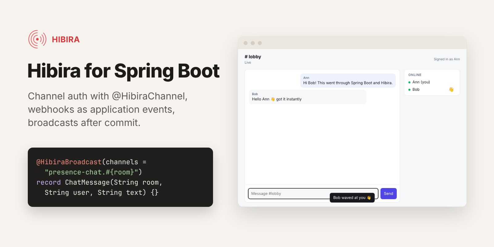
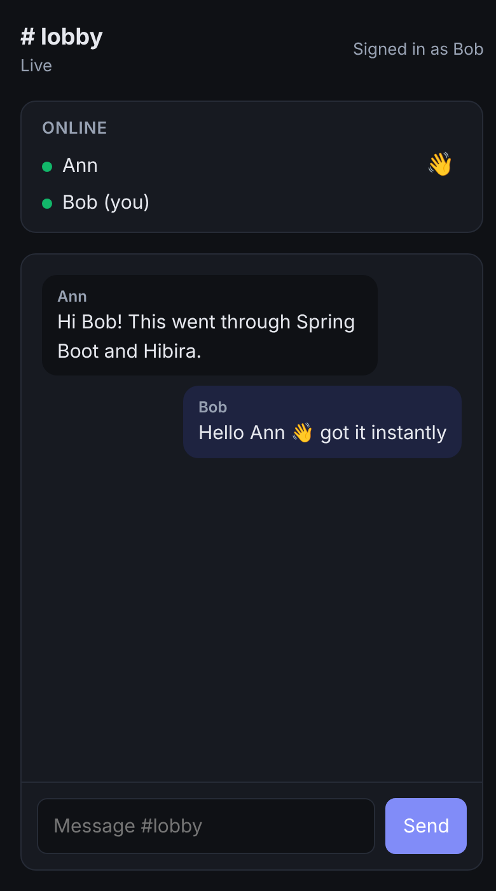

# Hibira for Java and Spring Boot



[](https://central.sonatype.com/artifact/io.hibira/hibira-spring-boot-starter)
[](https://github.com/hibira-io/spring-boot/actions/workflows/ci.yml)

Realtime for Spring Boot over [Hibira](https://hibira.io), without running a
WebSocket server, a STOMP broker or a message relay. Hibira is a hosted
realtime service that speaks the Pusher Channels protocol, so browsers and
apps connect with pusher-js, Laravel Echo or the mobile Pusher SDKs. This
starter is the server side, written the Spring way:

- **`Hibira`**, an injectable client: trigger events, read channels and
  presence members, send to signed-in users.
- **`@HibiraChannel`**: authorize private and presence channels with
  annotated bean methods. The starter serves the auth endpoint pusher-js
  calls and takes the user from Spring Security.
- **`@HibiraBroadcast`**: publish a Spring application event and it reaches
  the browsers, after the transaction commits (and not at all on rollback).
- **Webhooks as application events**: `@EventListener` on `WebhookEvent`
  for `member_added`, `channel_vacated`, `client_event` and the rest,
  signature checked for you.
- **Notification inbox**: store a notification per user, deliver it live,
  push it to users who are offline; the browser reads its own feed with a
  token from the starter.
- **Push notifications** to iOS, Android and browsers (Beams-compatible).
- **Approvals**: ask a person to approve before your code (or agent) acts,
  through a Hibira-hosted link.

| Artifact | What it is |
| --- | --- |
| `io.hibira:hibira-spring-boot-starter` | Auto-configuration, endpoints, `@HibiraChannel`, `@HibiraBroadcast`, webhook events |
| `io.hibira:hibira-java` | The HTTP API client on its own, for any Java 17+ code (no Spring) |

Works with Spring Boot 3.x and 4.x, on Spring MVC or WebFlux, Java 17 and up.

## Install

Maven:

```xml
<dependency>
  <groupId>io.hibira</groupId>
  <artifactId>hibira-spring-boot-starter</artifactId>
  <version>0.1.0</version>
</dependency>
```

Gradle:

```kotlin
implementation("io.hibira:hibira-spring-boot-starter:0.1.0")
```

Copy the app ID, key and secret from your app page on
[hibira.io/portal](https://hibira.io/portal) (the free plan needs no card)
into environment variables. Spring Boot binds them to `hibira.*`:

```sh
HIBIRA_APP_ID=your-app-id
HIBIRA_KEY=your-app-key
HIBIRA_SECRET=your-app-secret
# apps outside the default region also set HIBIRA_HOST=ws-<cluster>.hibira.io
```

The secret is shown only once, when you create the app; the app ID and key
stay under Overview → Credentials. On the Free plan, allowed origins can't
be `*`: add every origin your pages load from (`http://localhost:8080` while
developing, plus your production domain), or browsers are refused.

## Send events

```java
@Service
class OrderService {
    private final Hibira hibira;

    OrderService(Hibira hibira) {
        this.hibira = hibira;
    }

    void ship(Order order) {
        // ...
        hibira.trigger("private-orders." + order.id(), "order.shipped", Map.of("carrier", order.carrier()));
    }
}
```

Data is sent as JSON (a `String` as is). `trigger` also takes a list of
channels and a socket ID to leave out; `triggerBatch` sends up to 10 events in
one request; `sendToUser` reaches every tab of a signed-in user.

## Broadcast application events

Mark an event and publish it as usual. It is sent to Hibira once the
surrounding transaction commits, so clients never see a change that was
rolled back:

```java
@HibiraBroadcast(channels = "private-orders.#{orderId}", event = "order.shipped")
public record OrderShipped(long orderId, String carrier) {}

@Transactional
public void ship(long orderId) {
    // ...
    events.publishEvent(new OrderShipped(orderId, "DHL"));
}
```

Channel names are templates: `#{...}` is a SpEL expression on the event. For
more control, implement `HibiraBroadcastable` (channels, event name, data
and a socket to leave out, as methods).

## Authorize private and presence channels

```java
@Component
class Channels {

    @HibiraChannel("private-orders.{orderId}")
    boolean order(Principal user, long orderId) {
        return orders.isOwner(orderId, user.getName());
    }

    @HibiraChannel("presence-chat.{room}")
    Object room(HibiraUser user, String room) {
        return rooms.canJoin(room, user.id()) ? Map.of("name", user.id()) : false;
    }
}
```

`{name}` matches one part of the channel name and binds to the parameter of
the same name (or `@ChannelParam("name")`), converted to its type. Methods
can also take the `HibiraUser` and the `HibiraChannelRequest`. A method that
takes the principal or the user is only called for signed-in users. Return
`true` to allow, `false` or `null` to refuse; for a presence channel, any
other object is the member's user info, or return a `PresenceMember`. A
channel no pattern matches is refused.

The user comes from the request's principal (Spring Security, or any other
`Principal`). Its name is the user ID by default; define a
`HibiraUserResolver` bean to use your own IDs and add user info:

```java
@Bean
HibiraUserResolver hibiraUser(UserRepository users) {
    return principal -> {
        User u = users.findByEmail(principal.getName());
        return new HibiraUser(u.getId().toString(), Map.of("name", u.getName()));
    };
}
```

In the browser:

```js
import Pusher from 'pusher-js';

const pusher = new Pusher('your-app-key', {
  wsHost: 'ws.hibira.io', forceTLS: true, enabledTransports: ['ws', 'wss'], cluster: '',
  channelAuthorization: { endpoint: '/hibira/auth', headers: { 'X-XSRF-TOKEN': csrfToken } },
  userAuthentication: { endpoint: '/hibira/user-auth', headers: { 'X-XSRF-TOKEN': csrfToken } },
});

pusher.signin(); // enables hibira.sendToUser(...)
pusher.subscribe('private-orders.1042').bind('order.shipped', (data) => console.log(data));
```

Laravel Echo works the same way with `broadcaster: 'pusher'` and
`authEndpoint: '/hibira/auth'`.

### Spring Security

The endpoints are ordinary POSTs: they need the session, and the CSRF token
unless you exempt them. The webhook endpoint is called by Hibira, not a
browser, so let it through without a session or CSRF token (it checks the
request's signature itself):

```java
http
    .authorizeHttpRequests(a -> a.requestMatchers("/hibira/webhooks").permitAll().anyRequest().authenticated())
    .csrf(c -> c.spa().ignoringRequestMatchers("/hibira/webhooks"));
```

## Webhooks

Enter `https://your-app.example.com/hibira/webhooks` as the webhook URL on
your app page. Each verified event is published as a `WebhookEvent`:

```java
@EventListener(condition = "#event.name == 'member_added'")
void joined(WebhookEvent event) {
    log.info("{} joined {}", event.getUserId(), event.getChannel());
}
```

Requests with a wrong signature are refused with 401. During a secret
rotation the previous secret's signature is accepted too.

## Notification inbox

```java
hibira.sendInbox(InboxMessage.builder("Order #1042 shipped")
        .to("ann", "bob")
        .body("It should arrive on Tuesday.")
        .url("/orders/1042")
        .key("order-1042-shipped") // a retried send is not delivered twice
        .build());
```

Hibira stores one notification per user, sends it live to the user's open
tabs and apps, and pushes it to users who are not connected (when Hibira
Push is on). The browser reads and marks its own feed with a user token from
`GET /hibira/inbox/token`, so the
[`@hibira-io/inbox`](https://github.com/hibira-io/inbox) bell needs only
`tokenUrl: '/hibira/inbox/token'`. The server can also `listInbox`,
`markInbox`, `markAllInbox`, `deleteInbox` and `deleteAllInbox` for any user.

## Push notifications

Turn on Push notifications on your app page, then add the instance ID and
secret key:

```sh
HIBIRA_PUSH_INSTANCE_ID=your-instance-id
HIBIRA_PUSH_SECRET_KEY=your-push-secret-key
```

```java
hibira.publishToUsers(List.of("ann"), PushNotification.of("Order shipped", "Arriving Tuesday")
        .url("https://example.com/orders/1042"));
hibira.publishToInterests(List.of("news"), PushNotification.of("We're live", "Come say hi"));
```

`GET /hibira/push/token?user_id=...` hands the signed-in user's device a push
token: point the `TokenProvider` of
[@hibira-io/push-web](https://github.com/hibira-io/hibira-push-web),
[Android](https://github.com/hibira-io/hibira-push-android) or
[iOS](https://github.com/hibira-io/hibira-push-ios) at it.

## Approvals

```java
Approval a = hibira.requestApproval(ApprovalRequest.builder("Refund order #1042 for $89?")
        .details("Customer says the parcel never arrived.")
        .options("Refund", "Decline")
        .build());
// share a.url() with whoever decides, or send it with .pushUsers(...) / .channel(...)
Approval answer = hibira.awaitApproval(a.approvalId(), Duration.ofMinutes(10));
if (answer.isApproved()) { /* refund */ }
```

## Waiting room

Put a [Hibira waiting room](https://github.com/hibira-io/waiting-room) in front
of a ticket drop or launch page. Map path prefixes to rooms:

```properties
hibira.waiting-room.rooms[/drop]=presale
```

Visitors without a pass are redirected to the hosted queue page (non-GET
requests get a `403`). When it's their turn they come back with a signed pass,
which the filter checks and keeps in an HttpOnly cookie. Works on Spring MVC
and WebFlux. The pass is in the request (or exchange) attribute
`hibira.pass`:

```java
@GetMapping("/drop/{id}")
String drop(@RequestAttribute("hibira.pass") WaitingRoom.Pass pass) {
    return "Your number: " + pass.number(); // also ticketId(), expiresAt()
}
```

Create the room (rate, start time, `return_urls`) with the
[waiting rooms API](https://github.com/hibira-io/pusher-server/blob/master/docs/waiting-rooms.md).
A pass is valid for 30 minutes by default and works in any browser; if each
queue number may check out once, record `pass.ticketId()` and refuse a repeat.
Without Spring, `io.hibira.WaitingRoom.verifyPass(token, secret, "presale")`
checks a pass and `WaitingRoom.decide(...)` makes the same decision as the
filters.

## Without Spring

`hibira-java` works on its own:

```java
Hibira hibira = HibiraClient.create(HibiraOptions.builder()
        .appId(System.getenv("HIBIRA_APP_ID"))
        .key(System.getenv("HIBIRA_KEY"))
        .secret(System.getenv("HIBIRA_SECRET"))
        .build());

hibira.trigger("orders", "order.shipped", Map.of("id", 1042));
ChannelAuth auth = hibira.authorizeChannel(socketId, channelName); // return as JSON from your auth endpoint
Webhook webhook = hibira.verifyWebhook(key, signature, previousSignature, body);
```

It uses `java.net.http.HttpClient` and Jackson, and is thread-safe: keep one
per app. Failed requests throw `HibiraException` with the status and the
server's message.

## Configuration

| Property | Default | |
| --- | --- | --- |
| `hibira.app-id`, `hibira.key`, `hibira.secret` | | From your app page (required) |
| `hibira.host` | `ws.hibira.io` | `ws-<cluster>.hibira.io` for apps in another region |
| `hibira.port`, `hibira.use-tls` | 443, `true` | For a local or self-hosted server |
| `hibira.timeout` | `30s` | HTTP API request timeout |
| `hibira.push.instance-id`, `hibira.push.secret-key` | | Hibira Push |
| `hibira.push.token-ttl`, `hibira.inbox.token-ttl` | `1d` | Lifetime of the tokens the endpoints hand out |
| `hibira.endpoints.enabled` | `true` | Add the endpoints below |
| `hibira.endpoints.auth` | `/hibira/auth` | Channel authorization |
| `hibira.endpoints.user-auth` | `/hibira/user-auth` | `pusher.signin()` |
| `hibira.endpoints.webhooks` | `/hibira/webhooks` | Webhook URL |
| `hibira.endpoints.inbox-token` | `/hibira/inbox/token` | Inbox user token |
| `hibira.endpoints.push-token` | `/hibira/push/token` | Push token |
| `hibira.broadcast.enabled` | `true` | Send `@HibiraBroadcast` events |
| `hibira.waiting-room.rooms[<path>]` | | Waiting room protecting a path prefix |
| `hibira.waiting-room.host`, `.lang` | `https://<hibira.host>`, browser | Hosted waiting page origin and language |
| `hibira.waiting-room.previous-secret` | | Also accepted during a secret rotation |

Define your own `Hibira` bean to replace the client (for example a mock in
tests).

## Coming from Pusher

Code that uses `pusher-http-java` keeps working against Hibira: set the host
to `ws.hibira.io` and the credentials of your Hibira app. This starter adds
what that library leaves to you: the auth endpoints, annotation-based
channel rules, webhook verification wired to Spring events, transactional
broadcasts, and Hibira's inbox, push and approvals.

## Sample and tests

[`samples/chat`](samples/chat) is a Spring Boot 4 chat with Spring Security
login, a presence member list, `@HibiraBroadcast` messages and `sendToUser`
waves. Run it with your app's credentials:

```sh
mvn install -DskipTests
cd samples/chat && HIBIRA_APP_ID=... HIBIRA_KEY=... HIBIRA_SECRET=... mvn spring-boot:run
# open http://localhost:8080, sign in as ann / password and, in another browser, bob / password
```



`mvn verify` runs the unit and endpoint tests (Spring MVC and WebFlux). With
`HIBIRA_E2E_APP_ID`, `HIBIRA_E2E_KEY` and `HIBIRA_E2E_SECRET` set, it also
runs `HibiraLiveTest` against a real app. [`e2e/`](e2e) drives the sample in
two browsers (Playwright).

## License

MIT

## 中文摘要

Hibira 的 Java 與 Spring Boot 套件。`hibira-spring-boot-starter` 會依
`hibira.*` 設定自動建立可注入的 `Hibira` 用戶端，並提供：以
`@HibiraChannel` 註解方法授權 private／presence 頻道（使用者取自 Spring
Security）、`@HibiraBroadcast` 讓 Spring 應用事件在交易提交後送到瀏覽器、
Webhook 驗證後以 `WebhookEvent` 應用事件發布（用 `@EventListener` 接收）、
通知中心（inbox）、推播與人工審核（approvals）。支援 Spring Boot 3 與 4、
Spring MVC 與 WebFlux、Java 17 以上；不使用 Spring 時可單獨使用
`hibira-java`。前端用 pusher-js 或 Laravel Echo 連線即可。
等候室（waiting room）：設定 `hibira.waiting-room.rooms[/drop]=presale`，沒有 pass 的訪客會被導到 Hibira
託管的排隊頁，輪到時帶著簽名 pass 回來並存成 HttpOnly cookie（Spring MVC 與 WebFlux 皆可）。
